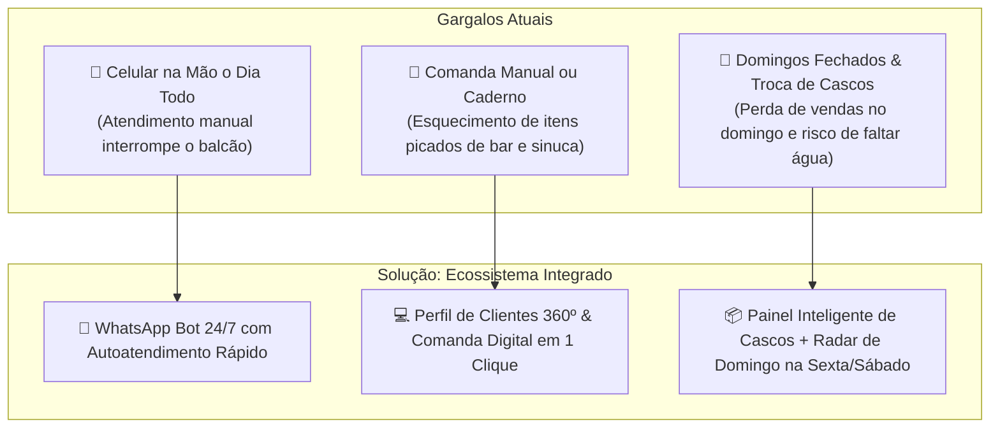
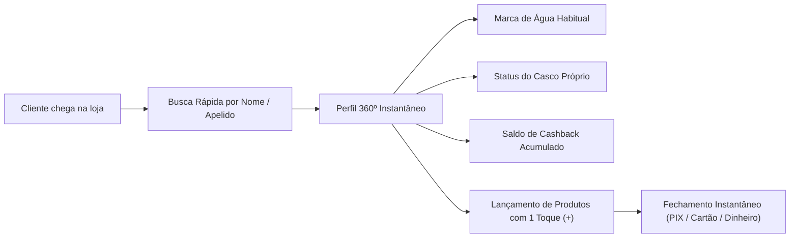
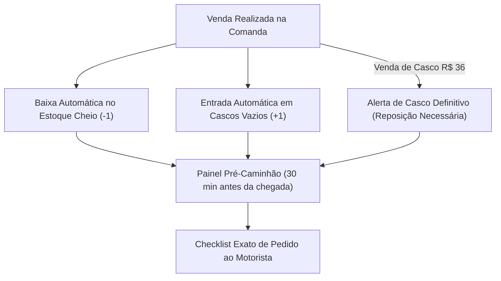
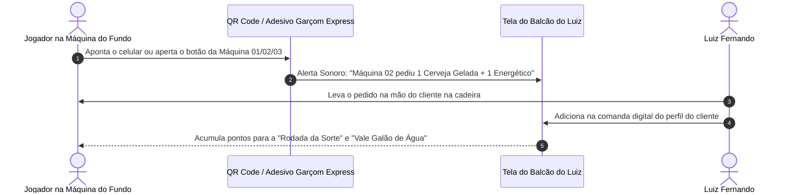
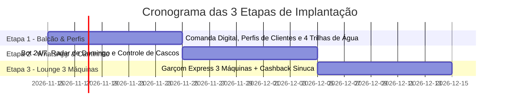

# PLANO DIRETOR DE AUTOMAÇÃO, COMANDA DIGITAL & ALAVANCAGEM DE VENDAS
## ECOSSISTEMA DE CRESCIMENTO ACELERADO: DEPÓSITO DE ÁGUA, BAR, SINUCA & LOUNGE

---

**Destinatário (Proprietário):**  
**Sr. Luiz Fernando**  
Diretor & Proprietário Geral  
*Estabelecimento: Depósito de Água, Bar, Sinuca & Lounge*  
*Base Atual: 130+ Clientes Recorrentes de Água 10L*  

**Consultor & Arquiteto de Sistemas:**  
**Glaucio Pires Pontes**  
Estratégia Digital, Automação de Negócios & Arquitetura de Sistemas  
*Tecnologia sob medida em Nuvem de Alta Performance*  

**Data da Proposta:** Novembro de 2026  
**Versão:** 1.0 – Executiva e Comercial  
**Status do Projeto:** Esboço & Especificação Técnica Homologada  

---

## 1. DIAGNÓSTICO ESTRATÉGICO: OPORTUNIDADES IMEDIATAS NA LOJA

Prezado **Luiz Fernando**,

Sua loja já possui um ativo valiosíssimo e altamente cobiçado no varejo local: **130 clientes recorrentes e fidelizados de água de 10 Litros**, além de fluxo constante na **mesa de sinuca**, no **bar de balcão** e nas **3 máquinas físicas de jogos no fundo da loja**.

Contudo, nossa imersão operacional identificou **3 grandes gargalos** que consomem o seu tempo, geram cansaço mental e deixam uma quantidade expressiva de dinheiro na mesa todos os dias:

### Detalhamento dos Gargalos Identificados:
1. **📱 Celular na Mão o Dia Todo no Balcão:**
   Hoje, todo pedido de água dos 130 clientes chega pelo WhatsApp de forma manual e despadronizada. Você precisa parar o atendimento presencial a todo instante para digitar, ler áudios, confirmar endereço e marca de água. Isso sobrecarrega a sua rotina e retarda a fila do balcão.
2. **📝 Comanda & Perfil no Balcão:**
   Os clientes da sinuca, das bebidas e das máquinas físicas consomem produtos fracionados ao longo de horas. Sem um sistema digital ágil de perfil individual, há risco real de esquecimento de itens consumidos, atrito na hora de cobrar e perda do histórico de preferências do freguês.
3. **🚚 Domingos Fechados & Troca Diária de Cascos do Caminhão:**
   Como a sua loja não abre aos domingos, seus clientes que ficam sem água no fim de semana acabam recorrendo a concorrentes. Além disso, o caminhão da distribuidora passa apenas **1 vez por dia** para recolher galões vazios e entregar galões cheios: qualquer erro de contagem paralisa as suas vendas no dia seguinte.

---

## 2. SISTEMA DE PERFIL DE CLIENTES 360º & COMANDA DIGITAL EM TEMPO REAL

Quando qualquer pessoa chegar na loja — seja para comprar um galão de água, jogar uma partida de sinuca, tomar uma cerveja no balcão ou apostar nas 3 máquinas físicas no fundo — você abrirá o perfil dela com **apenas 1 clique**:

### Funcionalidades do Módulo de Balcão:
* **Perfil Inteligente do Cliente (360º):**
  * Cadastro unificado com histórico de compras de água;
  * Registro de propriedade do casco (se o cliente tem casco próprio ou comprou completo);
  * Preferências de consumo (marca de água preferida, cerveja favorita, frequência de visitas).
* **Lançamento Rápido & Fechamento sem Fricção:**
  * Categorias organizadas: *Bebidas Alcoólicas, Não Alcoólicas, Fichas de Sinuca, Galões de Água 10L, Salgados e Doses*;
  * Adição de itens com 1 clique no botão `+`;
  * Fechamento automático de conta com cálculo de troco ou geração imediata de QR Code PIX na tela do balcão, garantindo **zero erro de soma e zero perda de caixa**.

---

## 3. PLANO DE MARKETING & ALAVANCAGEM: AS 4 TRILHAS DE LUCRO DA ÁGUA (10L)

Em vez de atuar como um mero depósito passivo aguardando o cliente pedir, vamos transformar sua tabela de preços em **4 Trilhas de Lucro e Fidelização Ativa**:

| Trilha Estratégica | Marca & Produto | Preço de Venda | Papel no Negócio & Mecânica de Alavancagem |
| :--- | :--- | :---: | :--- |
| **1. Saúde Premium & Assinatura** | **Água Ibirá 10L** | **R$ 30,00** | **Maior Margem Unitária:** Posicionada como água medicinal/premium (alto pH alcalino e vanádio). Criação do *"Clube Ibirá"*: o cliente deixa 4 galões pagos no início do mês, ganha um mimo no bar e antecipa receita garantida no seu caixa. |
| **2. Equilíbrio & Giro Semanal** | **Água Aldeinha 10L** **Água Levíssima 10L** | **R$ 17,00** **R$ 16,00** | **Giro Constante para Famílias:** Águas de excelente qualidade acima do padrão comum. O sistema sugere o *"Combo Duplo Semanal"* (leve 2 galões de uma vez e economize tempo e frete), dobrando o ticket médio de cada saída. |
| **3. Alto Volume & Atração** | **Água Crystal 10L (Refil)** | **R$ 13,00** | **Produto Campeão de Giro e Entrada:** Preço altamente competitivo para atrair vizinhos, novos moradores do bairro e converter transeuntes da rua e jogadores de sinuca. |
| **4. "Lock-in" (Trava de Fidelidade)** | **Crystal 10L Completa (Com Casco)** | **R$ 36,00** | **A Jogada de Mestre do Casco Reserva:** O cliente paga R$ 36,00 e o casco se torna propriedade dele. Implementamos a campanha do *"2º Casco Reserva em Casa"*: quem possui 2 cascos nunca fica sem água à noite e nunca compra no depósito concorrente! |

---

## 4. AUTOMAÇÃO DE WHATSAPP & OPERAÇÃO "DOMINGO GARANTIDO NA SEXTA E SÁBADO"

Como atender com perfeição mais de 130 clientes no WhatsApp sem passar o dia inteiro digitando no celular e, ao mesmo tempo, lucrar com os domingos em que o estabelecimento está de portas fechadas?

### 4.1. Autoatendimento Rápido no WhatsApp (Zero Digitação)
* O cliente envia uma mensagem como *"Boa tarde, preciso de água"*;
* O robô inteligente responde instantaneamente com botões de seleção rápida das 4 marcas (Ibirá R$ 30, Aldeinha R$ 17, Levíssima R$ 16, Crystal Refil R$ 13 ou Crystal Completa R$ 36);
* O cliente seleciona a opção e a forma de pagamento em 2 toques;
* O pedido cai **pronto e sonorizado na tela do seu balcão**, exibindo nome do cliente, endereço e itens solicitados. **Você não precisa digitar absolutamente nada.**

### 4.2. Antecipador Automático de Domingo ("Radar de Galão Vazio")
* A loja fecha aos domingos para descanso merecido. No entanto, domingo é o dia em que mais famílias percebem que a água acabou;
* Toda **Sexta-feira às 14h00** e **Sábado às 09h30**, o sistema analisa o histórico de consumo dos 130 clientes cadastrados;
* O sistema dispara automaticamente mensagens personalizadas:
  > *"Olá, [Nome do Cliente]! Lembramos que aos domingos nossa loja estará fechada. Que tal garantir seu galão de água hoje para não ficar na mão? Aproveite e inclua cerveja gelada, refrigerante ou gelo na mesma entrega!"*
* **Resultado Financeiro:** Você fatura o faturamento do domingo de forma antecipada entre sexta e sábado, aumentando o ticket médio com a venda combinada de bebidas geladas.

---

## 5. LOGÍSTICA INTELIGENTE: O CAMINHÃO DIÁRIO (VAZIOS X CHEIOS)

O caminhão da distribuidora passa apenas **1 única vez por dia** para recolher galões vazios e descarregar galões cheios. Um erro de contagem no estoque paralisa as vendas da tarde e do dia seguinte.

* **Painel de Cascos em Tempo Real:** Cada galão vendido na comanda dá baixa imediata no galão cheio e soma automaticamente +1 na contagem de *"Cascos Vazios Aguardando Caminhão"*;
* **Separação de Casco Vendido (R$ 36,00):** Quando o cliente compra o galão completo por R$ 36,00, aquele vasilhame não retorna mais para o depósito. O sistema sinaliza com precisão quantos cascos novos você deve recomprar da distribuidora para seu giro operacional não encolher;
* **Resumo Pré-Caminhão:** Faltando 30 minutos para o horário habitual do caminhão encostar, o sistema exibe um resumo mastigado: exatamente quantos galões de Ibirá, Aldeinha, Levíssima e Crystal você deve solicitar ao motorista.

---

## 6. SINUCA & TORNEIOS COM COMANDA VINCULADA

Transformamos a mesa de sinuca em um imã de vendas para o bar e para o consumo de água na residência dos próprios jogadores:

* **Comanda Rápida de Mesa:** Os jogadores ao redor da mesa abrem comandas conjuntas ou individuais. Fichas de sinuca, cervejas, doses e porções são lançadas instantaneamente, sem que a partida precise ser paralisada para cobrança a cada rodada;
* **Cashback da Sinuca na Água:**
  * **Regra de Fidelização:** A cada **R$ 50,00 consumidos em bebidas e sinuca** na semana, o cliente acumula automaticamente **R$ 3,00 de bônus** no seu perfil;
  * Esse saldo de cashback pode ser abatido exclusivamente na compra de uma **Água Ibirá 10L (R$ 30)** ou de um **Galão Completo Crystal (R$ 36)**;
  * O jogador de sinuca sai do bar levando água de alta qualidade para sua casa, integrando os dois lados do negócio.

---

## 7. CONCEITO EXCLUSIVO: "VIP LOUNGE EXPRESS" (AS 3 MÁQUINAS DO FUNDO)

### O Segredo Psicológico do Jogador:
Quem está sentado em frente às **3 máquinas físicas de jogos no fundo da loja** entra em estado de concentração e imersão total. Essa pessoa sente sede e vontade de consumir um refrigerante, cerveja ou salgado, mas **não se levanta da cadeira para ir até o balcão na frente da loja por medo de interromper a maré de sorte ou de ter sua máquina ocupada por outro jogador**.

### Mecânica de Implementação:
1. **Adesivo VIP Numerado & QR Code Garçom Express:**
   Fixação de identificadores modernos nas máquinas (*Máquina 01, Máquina 02 e Máquina 03*). Com a câmera do celular ou com 1 toque rápido em tela simples, o cliente visualiza o cardápio do bar: *Cerveja Gelada, Dose, Energético, Refrigerante, Água ou Salgado*;
2. **Aviso Sonoro no Balcão & Entrega VIP na Cadeira:**
   O pedido emite um aviso sonoro discreto na tela do seu balcão: *"Máquina 02 solicitou 1 Energético + 1 Cerveja"*. Você entrega o produto diretamente na mão do cliente e confirma o lançamento na comanda digital dele;
3. **Rodada da Sorte & Vale 5 Galões de Água Garantidos:**
   * A cada R$ 30,00 consumidos em produtos do bar durante o jogo nas máquinas, o sistema concede uma dose ou bebida cortesia para a próxima visita;
   * Quando o cliente conquistar uma premiação expressiva na máquina, o sistema permite oferecer na hora o **"Vale 5 Galões de Água Ibirá/Crystal Garantidos"**, incentivando o cliente a converter parte do prêmio em abastecimento doméstico pago à vista no seu estabelecimento!

---

## 8. PLANO DE IMPLANTAÇÃO PRÁTICA: 3 ETAPAS DE RESULTADO RÁPIDO

O sistema foi desenhado para ser intuitivo, ultrarrápido e livre de qualquer complicação tecnológica. Funciona perfeitamente em computador, notebook, tablet ou no próprio smartphone conectado à internet:

* **ETAPA 1 — BALCÃO & PERFIS (Pronto para Uso Imediato):**
  * Implantação do software de gestão de balcão com Perfis 360º de Clientes;
  * Comanda Digital ágil para produtos do bar, fichas de sinuca e água;
  * Parametrização da tabela oficial das 4 marcas de água e controle de casco da Crystal R$ 36.
* **ETAPA 2 — WHATSAPP & CAMINHÃO (Zero Celular na Mão):**
  * Ativação do robô de autoatendimento inteligente no WhatsApp para os 130 clientes cadastrados;
  * Configuração do disparo automático do "Radar de Galão Vazio" nas sextas (14h) e sábados (09h30) para antecipação do faturamento de domingo;
  * Ativação do painel de controle de vasilhames cheios vs. cascos vazios com alerta pré-caminhão.
* **ETAPA 3 — LOUNGE 3 MÁQUINAS (Aumento Real de Ticket Médio):**
  * Instalação física dos adesivos e QR Codes do "Garçom Express" nas 3 máquinas do fundo da loja;
  * Ativação dos alertas de pedidos de mesa/máquina diretamente na tela do balcão;
  * Ativação do programa de cashback integrado da sinuca e bônus das máquinas.

---

## 9. SIMULAÇÃO DE IMPACTO FINANCEIRO MENSAL ESTIMADO

Considerando apenas a base atual de **130 clientes de água** e a otimização do fluxo de bar e entretenimento:

| Alavanca de Faturamento | Impacto Operacional | Incremento Mensal Estimado |
| :--- | :--- | :---: |
| **Antecipação de Domingos (Radar de Galão Vazio)** | Resgate de clientes que compravam de concorrentes no domingo + venda combinada de bebidas | **+ R$ 1.800,00 a R$ 3.200,00** |
| **Campanha "2º Casco Reserva" (R$ 36,00)** | Adesão de 20% a 30% da base ao segundo vasilhame em casa | **+ R$ 936,00 a R$ 1.404,00** (lucro líquido direto) |
| **VIP Lounge Express (3 Máquinas do Fundo)** | Aumento no consumo de bebidas e salgados por jogadores que não levantavam da cadeira | **+ R$ 1.200,00 a R$ 2.400,00** |
| **Cashback Sinuca + Clube Ibirá** | Aumento da taxa de retorno para jogar e consumo da água premium de maior margem | **+ R$ 850,00 a R$ 1.600,00** |
| **TOTAL ESTIMADO DE GANHO ADICIONAL NO CAIXA** | **Crescimento direto e previsível sem aumentar o custo fixo** | **+ R$ 4.786,00 a R$ 8.604,00 / mês** |

---

## 10. PROPOSTA FINANCEIRA DE IMPLEMENTAÇÃO E SUSTENTAÇÃO

Apresentamos a estrutura de valores oficiais para o desenvolvimento, implantação e sustentação do projeto, desenhada para ter retorno sobre o investimento (ROI) já no primeiro mês de operação:

### 10.1. Implementação e Configuração Completa (Setup Inicial)
* **Valor do Investimento:** **R$ 1.800,00** (Taxa Única)
* **Condições Facilitadas de Pagamento:**
  * **Opção 1 (À Vista com Desconto):** R$ 1.710,00 (5% de desconto via PIX);
  * **Opção 2 (Parcelado):** Entrada de R$ 600,00 + 2 parcelas mensais de R$ 600,00 (ou em até 10x no cartão).
* **O que está 100% incluso:**
  * Cadastro unificado dos 130+ clientes recorrentes e preferências de águas;
  * Configuração e personalização do sistema de balcão (computador, tablet e celular);
  * Criação, testes e ativação do robô de autoatendimento WhatsApp 24/7;
  * Parametrização dos disparos preditivos do "Radar de Galão Vazio" (sextas e sábados);
  * Configuração do painel de logística do caminhão diário e balanço de cascos vazios vs. cheios;
  * Geração e instalação dos QR Codes e adesivos do menu digital "Garçom Express" nas 3 máquinas do fundo da loja e mesa de sinuca;
  * Treinamento presencial/remoto prático com o Sr. Luiz Fernando até total domínio da ferramenta.

### 10.2. Manutenção, Nuvem e Suporte Mensal (Sustentação Operacional)
* **Valor Mensal:** **R$ 250,00 / mês**
* **O que está 100% incluso:**
  * Hospedagem de alta performance em nuvem Serverless (tempo de resposta sub-100ms);
  * Backups diários e redundantes de todas as comandas, histórico de clientes e estoque;
  * Suporte técnico direto via WhatsApp para tirar dúvidas e ajustes imediatos;
  * Atualizações contínuas de segurança e melhorias de performance;
  * Monitoramento contínuo da estabilidade do robô de WhatsApp.

> [!NOTE]
> **Retorno do Investimento (ROI Imediato):** Com a antecipação de apenas **15 a 20 galões nos domingos fechados**, o faturamento recuperado já cobre com sobra a mensalidade de R$ 250,00, tornando o sistema um centro de lucro puro desde o primeiro mês.

---

## 11. ASSINATURA E CONTATO PROFISSIONAL

Esta proposta consolida o compromisso de entregar ao Sr. **Luiz Fernando** uma ferramenta prática, robusta e capaz de modernizar completamente a rotina do seu estabelecimento comercial.

**Consultor Responsável:**  
**Glaucio Pires Pontes**  
Estratégia Digital, Automação de Negócios & Arquitetura de Sistemas  
Localização: São Paulo - SP  

**Apresentado Exclusivamente Para:**  
**Sr. Luiz Fernando**  
Diretor / Proprietário do Estabelecimento  
*Depósito de Água, Bar, Sinuca & Lounge*  
Novembro de 2026
